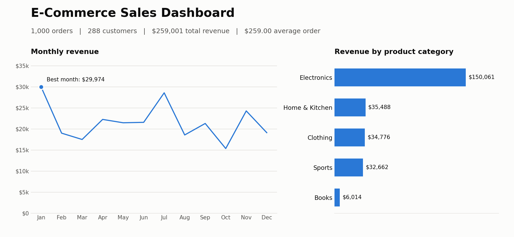

# E-Commerce Sales Analytics Pipeline

An end-to-end data analytics project built with Python, SQL and matplotlib. It generates realistic (synthetic) e-commerce orders with deliberate data quality problems, cleans them, stores them in a SQL database, analyses them with SQL and visualises the results.



## What it does

1. **Generate**: creates 1,000 fake orders (plus 25 duplicate rows) containing realistic mistakes: missing countries, missing quantities, negative prices and negative quantities.
2. **Ingest**: reads the messy data back from a CSV file.
3. **Clean**: removes duplicates, fixes data types, fills missing values, corrects negative numbers and calculates revenue.
4. **Store**: loads the clean table into a SQLite database.
5. **Analyse**: runs SQL queries (aggregations with `GROUP BY`) for revenue per month and per product category.
6. **Visualise**: draws a dashboard with matplotlib.

## Tech stack

- Python 3 (pandas, numpy)
- SQL (SQLite)
- matplotlib
- Git and GitHub

## Data cleaning decisions

| Problem found | How many | Fix |
|---|---|---|
| Duplicate rows | 25 | Removed |
| Missing country | 50 | Labelled "Unknown" |
| Missing quantity | about 30 | Filled with the median quantity |
| Negative quantity | about 15 | Converted to positive (treated as a sign typo) |
| Negative unit price | about 20 | Converted to positive (treated as a sign typo) |
| Order dates stored as text | All rows | Converted to real dates |

## Key findings

- Electronics generates about 58% of all revenue ($150k of $259k) from only about 21% of the orders.
- Monthly revenue moves between roughly $15k and $30k. January is the best month in this dataset.
- Books are the smallest category, at about $6k in revenue.

Note: the data is synthetic, so these findings reflect how the data was generated, not a real business.

## How to run it

```bash
git clone https://github.com/Krithiga-Sai/ecommerce-analytics.git
cd ecommerce-analytics
python -m pip install -r requirements.txt
python pipeline.py
python dashboard.py
```

`pipeline.py` creates `data/raw_orders.csv` and the database `ecommerce.db`. `dashboard.py` reads the database with SQL, prints the results and saves the chart as `dashboard.png`.

## Project structure

```
ecommerce-analytics/
    pipeline.py        generate, ingest, clean, store and verify the data
    dashboard.py       SQL queries and charts
    requirements.txt   Python libraries needed
    dashboard.png      output chart
    .gitignore         files Git should skip
```

## Possible next steps

- Add customer-level analysis (repeat customers, customer lifetime value) using SQL window functions
- Build a Power BI version of the dashboard
- Run the pipeline automatically on a schedule

## Author

Krithiga Sai - [GitHub](https://github.com/Krithiga-Sai)